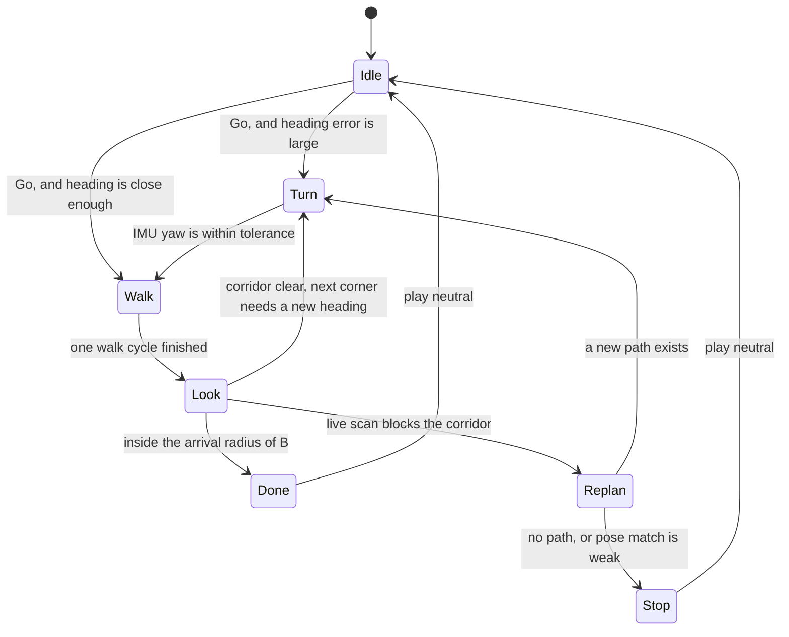

# Path planning and goal selection

How Twist-auto goes from a point A to a point B on a mapped room, using the IMU, the LiDAR, and the 12 Dynamixel servos, with the phone as the screen that picks the points.

The robot can do this. Saving the current grid is only half of it. Position has to be tracked while the map is built, then later scans have to be matched back to that saved room.

## Where phase 0 and phase 1 stand

Phase 0, firmware part:

- One gait cycle is 54 frames, 1.62 s. That repeat is exact in the clips: `walk_forward` and `walk_backward` are 19 cycles, `turn_left` and `turn_right` are 6. `neutral` is a separate 90-frame stand, not a cycle.
- `action stop`, `POST /api/action/stop`, and `POST /api/nav/stop` end the current clip and then play neutral.
- One cycle for a tape measure: serial `action walk_forward 1` or `POST /api/action/walk_forward?cycles=1`. Same for `walk_backward`, `turn_left`, and `turn_right`.

Phase 0, still on the robot, so path following must not use these yet:

- Metres travelled by one walk cycle.
- Degrees turned by one turn cycle.
- Body length and width, which set the inflation radius. A starting guess remains 0.25 m until the body is measured.

Phase 1, firmware part:

- Yaw is the calibrated IMU heading.
- `x` and `y` stay put unless three things are true together: the scan already matches the map (at least 12 beam hits), a walk clip is the action actually running, and a neighboring 5 cm cell matches at least 4 hits better. The pose then steps one cell, not up to 30 cm.
- A still robot no longer slides the arrow. Turns change yaw and do not add translation.
- `GET /api/pose` and the pose fields in `/api/live.json` report that pose. `localized` is true only when the match score is at least 12.

Phase 1, still to confirm on the robot after this firmware is flashed:

1. Calibrate, start the scan, stand still. The arrow must stay at the origin once it says pose locked. It must not drift the way the previous log did (`0.00, 0.00` walking off to `0.30, 0.35` with nobody moving).
2. `action walk_forward 1`. The arrow should leave the origin by about one step, and the serial log should show `pose` lines only during that clip.
3. `action turn_left 1`. Yaw should change. `x` and `y` should stay where they were.

## What the firmware can do today

The live map is a 200×200 grid, 5 cm cells, covering 10 m × 10 m. The corner of that grid is world coordinate (−5 m, −5 m). Each cell is an int8 log-odds value: above 0 is occupied, below 0 is free, 0 is unknown. The app already draws this from `GET /api/map.bin`, and it draws the latest scan from `GET /api/live.json` or the WebSocket `/ws/live`.

`live_map_get_state()` reports yaw from the calibrated IMU and `x`, `y` from the scan match described above. Rays are drawn from that pose. Until a walk clip is playing and the match is strong, `x` and `y` stay where they are.

The IMU supplies roll, pitch, yaw, and yaw rate after `POST /api/imu/calibrate`. It does not supply translation. The motors are 12 Dynamixel AX servos playing fixed clips:

| Action | Frames | Duration at 30 ms/frame |
|---|---:|---:|
| `neutral` | 90 | 2.7 s |
| `walk_forward` | 1026 | 30.8 s |
| `walk_backward` | 1026 | 30.8 s |
| `turn_left` | 324 | 9.7 s |
| `turn_right` | 324 | 9.7 s |

There is no cancel, no “walk 0.4 m”, and no encoder odometry. A play request returns immediately with `"msg":"queued"`. One action runs at a time.

There is a second, older grid baked into the firmware (`main/embed/embed.c`): 400×400 at the same 5 cm resolution, origin (−10 m, −10 m), so 20 m × 20 m. `map_compare_last_scan()` in `main/map.c` assumes the robot is at (0, 0) and already notes that scan-match localisation is the next step. Navigation uses the live 10 m grid, not that baked file.

Frame already used everywhere: x is forward, y is left, yaw is counterclockwise, and yaw 0 is the heading set by IMU calibrate (the front arrow).

Wi-Fi for the phone: SSID `Twist-auto`, password `twistmap1`, base URL `http://192.168.4.1`. `GET /api` is the endpoint catalog.

## The behaviour we are aiming at

1. Calibrate the front heading. Start the scan. Drive the robot around the room with short walks and turns. The map fills in and the arrow moves.
2. Save that grid as the room. Later scans do not wipe the walls.
3. On the phone, the arrow is the live pose. **Set A** stores that pose. A tap on a free cell stores **B**.
4. **Plan** draws a polyline from the live pose to A (if the robot is not already there) and then from A to B. The path stays on cells that were seen free, and it stays a body-width away from walls.
5. **Go** hands the mission to the firmware. The robot turns to face the next bend, walks a short piece, and stops. If a new scan blocks the corridor, it stops, marks that blob as a live obstacle, plans again, and continues. At B it plays `neutral` and reports done.
6. If the pose match goes bad, or no free path remains, it plays `neutral` and the phone shows why. It does not keep walking.

A and B are fixed world points in metres. **Go** always starts from the pose at that moment. If that pose is more than about 0.3 m from the stored A, the first leg is “walk to A”, then “walk to B”. If **Set A** was pressed while standing on the arrow, the first leg is already done.

Arrival radius starts around 0.25 m. Expect the robot to finish near B, not on the exact pixel. Quadruped clips cannot track a polyline smoothly.

## How position is found

Saving `map.bin` records the room. It does not record where the robot is. Position is a pose `(x, y, yaw)` updated on the robot:

- **Heading** comes from the calibrated IMU yaw. That part already exists.
- **Prediction** comes from the gait. After one measured walk cycle, add `(step_length * cos yaw, step_length * sin yaw)`. A turn cycle trusts the IMU and does not invent translation. This prediction drifts, so it is only the guess for the next match.
- **Correction** comes from the LiDAR. Each revolution is matched to the grid in a small window around the guess, on the order of ±0.3 m and ±10°. The score is how many beam endpoints land on occupied cells. The best offset becomes the pose. A weak score sets `localized` false.

Rays must be drawn from that pose. Drawing them from (0, 0) is what pins the robot to the middle of the map today.

### Two grids

Use two grids of the same size (200×200, 5 cm, origin −5 m, −5 m):

| Grid | What it stores | When it changes |
|---|---|---|
| Static room | Walls and furniture mapped on purpose | Updated while mapping. Frozen by Save. Restored after reboot. |
| Live obstacles | Hits in the latest scans that are not already walls | Updated every scan. Old blobs fade when the beam no longer hits them. |

People and chairs that were walked past stay on the live layer, so a later replan can go through that spot again. Unknown cells are blocked in the first version. The robot only crosses floor it has already seen.

The 10 m × 10 m window stays centered on the pose once the robot can leave the middle of the room. 40,000 cells is small enough to plan on the ESP32-P4. A second live layer plus A* bookkeeping (on the order of a few bytes per cell) fits.

Cell index, matching the code already in `live_map.c`:

```text
ix = floor((x - origin_x) / 0.05)
iy = floor((y - origin_y) / 0.05)
index = iy * 200 + ix
```

`origin_x` and `origin_y` are −5 m until the window starts recentering.

### Numbers to measure before the follower is trusted

Write these down from the real robot. They are inputs, not guesses baked into the planner:

- Body length and width. The inflation radius comes from that rectangle. A starting guess is 0.25 m, which is 5 cells, until the body is measured.
- Metres travelled by one repeat of the walk clip.
- Degrees turned by one repeat of the turn clip.

The walk clip is 1026 frames, so it is many steps, not one command. The follower needs one cycle and a cancel, not the whole 31-second clip. Find the repeat length inside `walk_forward` / `turn_left` before Phase 5.

## Who does what

The phone is the map UI and the mission editor. The firmware owns the pose, both grids, the path follower, and the safety stop.

After **Go**, the mission runs on the robot. A dropped Wi-Fi link must stop the servos into `neutral`, not leave a gait running with nobody watching. The phone is how you watch and how you cancel. It is not the thing that has to send every step.

Global planning is A* on the 8-neighbour grid. Cost is the static cell plus the live cell, inflated by the body radius. The path is then thinned to corners that have a straight free line of sight between them.

The follower state machine:



## Endpoints to add

These sit next to the catalog already served at `GET /api`. Existing `/api/map.bin`, `/api/live.json`, and `/ws/live` stay the display feed. Pose `x` and `y` in `/api/live.json` start meaning a real position once Phase 1 lands. Until then they are 0.

| Method | Path | Role |
|---|---|---|
| GET | `/api/pose` | `x`, `y`, `yaw_deg`, `localized`, match score |
| POST | `/api/map/save` | Freeze the static grid to a file on the robot |
| POST | `/api/map/load` | Load that file back into the static grid |
| GET | `/api/map/static.bin` | The saved room, same 200×200 int8 layout as `/api/map.bin` |
| POST | `/api/nav/goal` | Body `{"a":{"x","y"},"b":{"x","y"}}`. Reject a point in an occupied or unknown cell. |
| POST | `/api/nav/plan` | Run A* from the live pose. Return the polyline in metres, or `no_path`. |
| POST | `/api/nav/start` | Start the follower on the last plan. |
| POST | `/api/nav/stop` | Cancel the gait and play `neutral`. |
| GET | `/api/nav` | `state`, current waypoint, goal, last reason (`ok`, `blocked`, `lost`, `done`) |

`POST /api/nav/goal` example:

```json
{"a": {"x": 0.10, "y": -0.05}, "b": {"x": 2.40, "y": 1.10}}
```

`POST /api/nav/plan` example on success:

```json
{
  "ok": true,
  "from": {"x": 0.12, "y": 0.02, "yaw_deg": 4.0},
  "path": [
    {"x": 0.12, "y": 0.02},
    {"x": 1.20, "y": 0.15},
    {"x": 2.40, "y": 1.10}
  ]
}
```

On failure: `{"ok": false, "reason": "no_path"}` or `"occupied"` or `"unknown"` or `"lost"`.

Store the static grid as a file on a SPIFFS (or FAT) partition, about 40 KB for the int8 cells plus a few bytes for resolution, origin, and the inflation radius. NVS is the wrong place for a 40 KB grid. The phone can keep its own copy from `GET /api/map/static.bin`, but reboot recovery has to work with the phone absent, so the robot keeps the file.

## Phone application

The page at `GET /` is HTML stored in the firmware (`main/www/index.html`). That page pulls pose, scan, and the grid and draws the canvas itself. The mobile app should skip `/` and call the same JSON and binary endpoints, and draw its own screen. Both clients look at one pose and one mission on the robot.

Reuse the same world-to-screen mapping the firmware page already uses: x forward is up, y left is screen-left. Draw in this order:

1. Static grid (`/api/map/static.bin`, or `/api/map.bin` until the split exists).
2. Live scan dots from `/api/live.json` or `/ws/live`.
3. Arrow at `/api/pose`.
4. Polyline from `/api/nav`.
5. Markers for A and B.

Taps convert back from screen to metres with that same scale. **Set A** copies `/api/pose`. A second mode, **Set B**, writes the tap, after the firmware (or a local check against the grid) accepts the cell. **Plan** calls `POST /api/nav/plan`. **Go** calls `POST /api/nav/start`. **Stop** is always on screen and calls `POST /api/nav/stop`.

Show `x`, `y`, `yaw_deg`, and whether `localized` is true. If the live pose and the stored A differ by more than about 0.3 m when **Go** is pressed, the UI says the first leg is “walk to A”.

The built-in page at `GET /` can grow the same controls later. The phone app is the one this plan is written for.

## Phases

Each phase ends with something visible on the robot before the next one starts.

### Phase 0 — Measurements and this write-up

Time one walk cycle and one turn cycle. Record distance and degrees. Record the body rectangle. Choose the inflation radius from that rectangle.

Exit: those three numbers are written down, and the gait player can be stopped mid-clip. Nothing autonomous yet.

Firmware in this phase: a cancel flag in the action player (`main/actions.c`) so `POST /api/nav/stop` and a later obstacle check can cut a clip and play `neutral`. Find the frame period of one cycle inside the walk and turn bins.

### Phase 1 — A pose that moves

This is the first feature phase. Until it is true, A and B are labels on an empty centre cell.

Add the predict-and-scan-match pose. Draw rays from `(x, y, yaw)` instead of from the origin. Put real `x` and `y` into `/api/live.json` and add `GET /api/pose`.

Exit: press Forward and the arrow leaves the centre of the map. Press Left and the heading changes without smearing the whole room into a circle.

### Phase 2 — A room you can save

Split the static grid from the fading live layer. Add save, load, and `GET /api/map/static.bin`.

Exit: map the room, reboot, load, and the walls are back. A person walking through the scan appears and then fades, and the saved walls stay.

### Phase 3 — Pick A and B on the phone

Pose readout, Set A, tap B, reject illegal cells, draw both markers.

Exit: the numbers on the phone match the arrow, and B cannot be placed inside a wall or on an unknown cell.

Phases 3 and 4 can be built against a pose set by hand so the UI can move ahead, but **Go** waits until Phase 1 and Phase 5 both hold.

### Phase 4 — Plan only

A* plus line-of-sight shortcut. `POST /api/nav/goal` and `POST /api/nav/plan`. Draw the polyline. No servos on this phase.

Exit: a goal across the room returns a path that stays off the walls, and a walled-off goal returns `no_path`.

### Phase 5 — Follow that path

One-cycle walk and turn, cancel, the state machine above, `POST /api/nav/start` and `POST /api/nav/stop`.

Exit: on an empty mapped floor the robot turns, walks, and stops in `neutral` inside the arrival radius of B.

### Phase 6 — Live obstacles

If the forward corridor hits the live layer, stop, replan, continue or give up.

Exit: a person stepping into the path makes the robot stop and take another free route, or stop in `neutral` when none exists.

### Phase 7 — Recovery

A weak scan-match stops the mission. The phone shows `lost` or `blocked`. The 10 m window recenters when the pose nears an edge.

Exit: blocking the LiDAR or picking the robot up stops the gait instead of dragging a fake path.

## Firmware work, by area

| Area | Files today | What changes |
|---|---|---|
| Pose | `main/live_map.c`, `main/imu.c`, `main/lidar.c` | Pose state. Gait prediction. Correlative match each revolution. `integrate_scan` uses the pose. `GET /api/pose`. |
| Map layers | `main/live_map.c` | Static grid and decaying live grid. Save and load on SPIFFS. `GET /api/map/static.bin`. |
| Actions | `main/actions.c` | Cancel. Play N cycles of a clip instead of the whole bin. `neutral` after cancel. |
| Planner | new module, called from `main/wifi_app.c` | Inflate, A*, shortcut, goal checks. |
| Follower | new module | State machine. Corridor check against the live layer. Mission abort on Wi-Fi drop and on weak pose. |
| HTTP | `main/wifi_app.c` | The new routes, and the `/api` catalog text. |
| Display page | `main/www/index.html` | Optional later. Same controls as the phone, still just a client of the API. |

The follower and the scan matcher run on the ESP32-P4. The phone does not stream step commands.

## Application work, by screen

One map screen is enough.

- Connect to `192.168.4.1`, poll `/api/live.json` or open `/ws/live`, and refetch the grid when `map_version` changes. This is what `index.html` already does.
- After Phase 1, read `/api/pose` (or the pose fields in the live JSON) for the arrow.
- After Phase 2, draw `/api/map/static.bin` as the room and keep the live scan as dots on top.
- Buttons: Calibrate, Start scan, Stop scan, Set A, Set B, Plan, Go, Stop. Set B is also a tap on the canvas.
- Mission strip: follower state and `reason` from `GET /api/nav`.

Illegal taps (occupied, unknown, outside the grid) are not stored. The phone can grey them out locally and still trust a 4xx from `POST /api/nav/goal`.

## What this plan leaves out

Smooth velocity control of the legs. Planning through unknown space. Using the old 20 m embedded map as the room. Continuous dynamic-window avoidance. Those can wait until a mission can start at A, stop at B, and refuse to walk into a person.

## Suggested order of implementation

1. Phase 0 cancel flag, and measure step length, turn angle, and body size.
2. Phase 1 pose, because every later picture is wrong while `x` and `y` stay 0.
3. Phase 2 save/load, so a mapped room survives a reboot.
4. Phase 3 and Phase 4 on the phone and in `wifi_app.c`, still with servos idle.
5. Phase 5 follower, then Phase 6 replan, then Phase 7 stop-when-lost.
